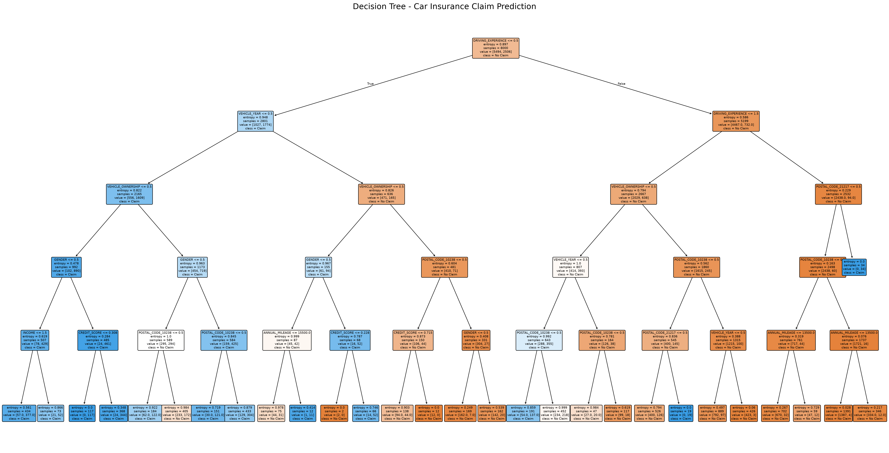
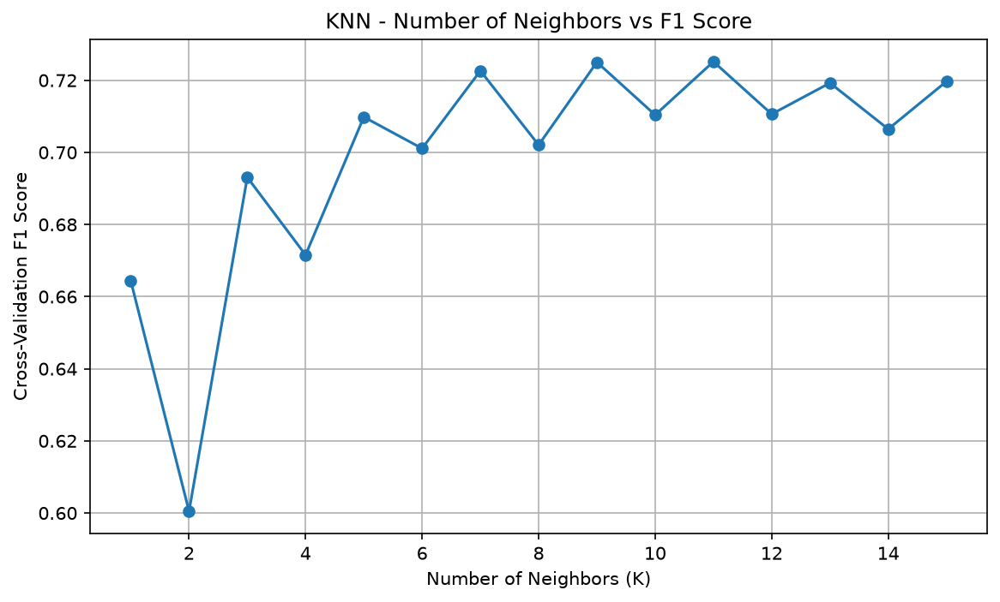

# Car Insurance Claim Prediction — ML Assignment 2

**Course:** Machine Learning  
**Programme:** M.Tech (Artificial Intelligence and Machine Learning)  
**Institution:** BITS Pilani WILP  
**Application:** ClaimLens Studio  
**Deployment:** [Launch ClaimLens Studio](https://car-insurance-ml-assignment-2-h6a7jnf54ixmwuudp87ry6.streamlit.app/)

## 1. Problem Statement

The objective is to predict whether a customer will make a car insurance claim using demographic information, driving history, and vehicle-related attributes. This is a **binary classification** task:

- **0:** No insurance claim
- **1:** Insurance claim

Five classification algorithms were trained on the same dataset and evaluated on the same held-out test set.

## 2. Dataset Description

**Dataset:** Car Insurance Claim  
**Source:** [Kaggle — Car Insurance Data](https://www.kaggle.com/datasets/sagnik1511/car-insurance-data)

| Attribute | Description |
|---|---|
| Total records | 10,000 |
| Original columns | 19 |
| Input features (excluding ID and target) | 17 |
| Target variable | `OUTCOME` |
| Problem type | Binary classification |
| Training samples | 8,000 (80%) |
| Testing samples | 2,000 (20%) |

The input features describe customer demographics, driving experience, credit history, vehicle characteristics, speeding violations, DUIs, and past accidents.

### Class distribution

| Target | Records | Percentage |
|---|---:|---:|
| No claim (`0`) | 6,867 | 68.67% |
| Claim (`1`) | 3,133 | 31.33% |

## 3. GitHub Repository

[Car-Insurance-ML-Assignment-2](https://github.com/kanika010ds/Car-Insurance-ML-Assignment-2)

## 4. Data Preprocessing

The preprocessing workflow performs the following steps:

1. Removes the identifier `ID` from model input and separates `OUTCOME` as the target.
2. Creates a **stratified 80/20 train–test split** (`random_state=42`).
3. Fits median imputation on the **training set only** and applies it to training and test features.
4. Converts categorical variables with ordinal/binary mappings and one-hot encodes `POSTAL_CODE` using an encoder fitted on training data.
5. Produces **20 encoded model-input columns** in a consistent order.
6. Fits `StandardScaler` on training data for models requiring feature scaling. The KNN saved pipeline contains its own scaler.
7. Exports the untouched-feature held-out test split (including the target) to `test_data.csv`.
8. Saves fitted preprocessing objects in `models/` for reuse by the Streamlit app without retraining.

### Missing values in the original dataset

| Feature | Missing values | Treatment |
|---|---:|---|
| `CREDIT_SCORE` | 982 | Training median imputation |
| `ANNUAL_MILEAGE` | 957 | Training median imputation |

Saved preprocessing artifacts include `imputer.joblib`, `postal_encoder.joblib`, `scaler.joblib`, and `feature_columns.joblib`.

## 5. Classification Models and Evaluation

Five classifiers were implemented:

1. **Logistic Regression** — scaled features.
2. **Decision Tree** — entropy criterion, maximum depth 5 (exploratory comparison with depth 4).
3. **K-Nearest Neighbors (KNN)** — `K=11` selected by five-fold cross-validation on training data, using F1 as the selection metric.
4. **Gaussian Naive Bayes** — encoded features.
5. **Support Vector Machine (SVM)** — RBF kernel, `C=1.0`, `gamma="scale"`, scaled features.

All five models were evaluated on the **same 2,000 held-out test records** using **Accuracy, ROC-AUC, Precision, Recall, F1 Score, and Matthews Correlation Coefficient (MCC)**.

## 6. Model Performance Comparison

| ML Model | Accuracy | AUC | Precision | Recall | F1 | MCC |
|---|---:|---:|---:|---:|---:|---:|
| Logistic Regression | **0.8455** | **0.9158** | 0.7548 | 0.7512 | **0.7530** | **0.6406** |
| Decision Tree (Depth 5) | 0.8395 | 0.9001 | **0.7812** | 0.6778 | 0.7259 | 0.6163 |
| KNN (K=11) | 0.8145 | 0.8871 | 0.7000 | 0.7145 | 0.7072 | 0.5715 |
| Gaussian Naive Bayes | 0.7885 | 0.8692 | 0.6278 | **0.7990** | 0.7032 | 0.5521 |
| SVM (RBF) | 0.8430 | 0.9034 | 0.7441 | 0.7608 | 0.7524 | 0.6375 |

**Primary selection metric:** F1 Score, chosen to assess the balance between precision and recall for the claim class in this moderately imbalanced dataset.

## 7. Model Performance Observations

### Logistic Regression

Logistic Regression achieved **84.55% accuracy**, **0.7530 F1**, **0.9158 AUC**, and **0.6406 MCC**. It correctly classified **1,691 of 2,000** test records. Precision (0.7548) and recall (0.7512) were closely balanced. It produced the highest F1, accuracy, AUC, and MCC among the five models.

### Decision Tree

The Decision Tree used entropy-based splitting. Tree depths of 4 and 5 were compared during exploratory analysis.

| Evaluation metric | Depth 4 | Depth 5 |
|---|---:|---:|
| Accuracy | 0.8260 | **0.8395** |
| AUC | 0.8893 | **0.9001** |
| Precision | 0.7321 | **0.7812** |
| Recall | **0.7018** | 0.6778 |
| F1 Score | 0.7166 | **0.7259** |
| MCC | 0.5914 | **0.6163** |

| Confusion matrix component | Depth 4 | Depth 5 |
|---|---:|---:|
| True negatives (TN) | 1212 | 1254 |
| False positives (FP) | 161 | 119 |
| False negatives (FN) | 187 | 202 |
| True positives (TP) | 440 | 425 |

Depth 5 improved five of six metrics, including F1, but decreased recall. It produced fewer false positives and more missed claims. **Depth 5 was retained provisionally** based on exploratory test results; selecting the depth using cross-validation on training data would be methodologically stronger.

**Decision Tree visualization:**



A vector version is available as `decision_tree_visualization.pdf`.

### K-Nearest Neighbors (KNN)

Values from **K=1 through K=15** were compared using five-fold training-set cross-validation. The highest average validation F1 was **0.7252 at K=11** (K=9 was very close at 0.7250). K=11 was retained for the saved KNN classifier.

On held-out test data, KNN obtained **81.45% accuracy**, **0.7072 F1**, and **0.5715 MCC**. It correctly classified **1,629 of 2,000** records, detecting 448 actual claims, missing 179, and producing 192 false positives. KNN recall (0.7145) was higher than Decision Tree recall (0.6778), but its overall F1 was lower.

**K selection visualization:**



### Gaussian Naive Bayes

Gaussian Naive Bayes achieved **78.85% accuracy**, **0.8692 AUC**, **0.7032 F1**, and **0.5521 MCC**. It identified **501 of 627 actual claims**, missing 126, but produced 297 false-positive claims. Its **recall of 0.7990 was the highest** among the five classifiers, while its precision (0.6278) and accuracy were the lowest. This may be useful when missing a true claim is particularly costly, although it increases false alarms.

### Support Vector Machine (SVM)

SVM used an **RBF kernel** on scaled features with `C=1.0` and `gamma="scale"`. It achieved **84.30% accuracy**, **0.9034 AUC**, **0.7524 F1**, and **0.6375 MCC**. Its confusion matrix contained 1,209 TN, 164 FP, 150 FN, and 477 TP.

SVM performed very similarly to Logistic Regression. Its recall (0.7608) was slightly higher, while its accuracy, AUC, precision, F1, and MCC were slightly lower.

### Overall Winner

**Selected winner: Logistic Regression**, based on the highest F1 Score (**0.7530**), as well as the highest accuracy, AUC, and MCC. **SVM is a close alternative**, with F1 of **0.7524**; this small observed difference does not establish that one will always generalize better.

## 8. Streamlit Web Application — ClaimLens Studio

**ClaimLens Studio** is a dark-themed interactive car insurance classification dashboard built with Streamlit. The interface includes insurance-themed images, a five-model selector, CSV upload, performance charts, comparison tables, a confusion matrix, classification reports, and downloadable prediction results.

The application supports:

- Uploading a CSV containing the original input features and `OUTCOME` target.
- Choosing any of the five saved classifiers.
- Calculating the six required evaluation metrics on uploaded labeled data.
- Displaying active model performance graphs and a confusion matrix.
- Showing the five-model benchmark comparison from the original held-out dataset.
- Downloading predicted classes and claim probabilities as CSV.

**No training takes place in the web application.** Saved fitted models and preprocessing objects are loaded with `joblib`.

### How to use the dashboard

1. Open the [live application](https://car-insurance-ml-assignment-2-h6a7jnf54ixmwuudp87ry6.streamlit.app/).
2. Choose a classification model from the sidebar (Logistic Regression, Decision Tree, KNN, Gaussian Naive Bayes, or SVM).
3. Upload `test_data.csv`, or another CSV containing the same original feature columns and a binary `OUTCOME` column.
4. Inspect Accuracy, AUC, Precision, Recall, F1 Score, MCC, the metric chart, confusion matrix, and classification report.
5. Download the file containing predictions and claim probabilities, if needed.
6. Review the five-model comparison table and chart. This comparison represents the original held-out test set, not a recalculation for every uploaded dataset.

**Input format:** The uploaded CSV must contain the original feature names expected by the application and a ground-truth `OUTCOME` column with values `0` or `1`. The `ID` column, when present, is not used as a predictor. The provided `test_data.csv` is the recommended example. AUC requires both classes to be present in the uploaded labels.

### Run locally

Use Python 3.11 and install the dependencies:

```bash
python -m pip install -r requirements.txt
python -m streamlit run app.py
```

Upload the provided `test_data.csv` to reproduce the model evaluations. The app's stored comparison table is based on the original held-out test set; the active model metrics are calculated for the uploaded CSV.

### Live Streamlit application

**Live app:** [ClaimLens Studio on Streamlit Community Cloud](https://car-insurance-ml-assignment-2-h6a7jnf54ixmwuudp87ry6.streamlit.app/)  

**Repository:** [GitHub — Car-Insurance-ML-Assignment-2](https://github.com/kanika010ds/Car-Insurance-ML-Assignment-2)

## 9. Project Files

```text
Car-Insurance-ML-Assignment-2/
├── app.py
├── data_preprocessing.py
├── train_models.py
├── README.md
├── requirements.txt
├── test_data.csv
├── .streamlit/
│   └── config.toml
├── assets/
│   ├── hero_car.png
│   ├── sidebar_insurance.png
│   └── road_footer.png
├── models/
│   ├── logistic_regression.joblib
│   ├── decision_tree.joblib
│   ├── knn.joblib
│   ├── naive_bayes.joblib
│   ├── svm.joblib
│   ├── imputer.joblib
│   ├── postal_encoder.joblib
│   ├── scaler.joblib
│   └── feature_columns.joblib
├── decision_tree_visualization.png
├── decision_tree_visualization.pdf
└── knn_k_selection.png
```

## 10. Project Status

### Completed

- Selected and explored the Car Insurance Claim dataset.
- Completed data preprocessing and an 80/20 stratified train–test split.
- Trained, evaluated, and saved all five classification models.
- Compared the models using the six required classification metrics.
- Documented model-specific observations and identified Logistic Regression as the overall winner by F1 Score.
- Generated Decision Tree and KNN analysis visualizations.
- Saved the preprocessing artifacts and held-out test CSV.
- Developed and tested the ClaimLens Studio dashboard.
- Pushed the project to GitHub on the `main` branch.
- Cloned and launched the application in the BITS Virtual Lab environment.
- Deployed ClaimLens Studio to Streamlit Community Cloud and obtained its live application URL.

## 11. Reproducibility and Deployment Notes

- **Evaluation data:** All benchmark metrics in Section 6 were obtained from the same 2,000-record held-out test split. The exact test records are provided in `test_data.csv`.
- **Saved models:** The `models/` directory contains the five trained classifiers and fitted preprocessing artifacts. These are loaded for predictions; the Streamlit app does not retrain models.
- **Training scripts:** `data_preprocessing.py` handles preparing the dataset and preprocessing objects; `train_models.py` handles model training/evaluation. The saved artifacts allow running the dashboard without downloading or refitting the original dataset.
- **Dependencies:** Install packages from `requirements.txt` in a compatible Python environment (Python 3.11 was used for project development).
- **Hosting:** Streamlit Community Cloud builds the application from the GitHub `main` branch and uses `app.py` as the entry point.
- **Scope:** This is an academic machine-learning demonstration. Its predictions should not be treated as automated insurance eligibility or claims decisions without further validation, calibration, and governance.

